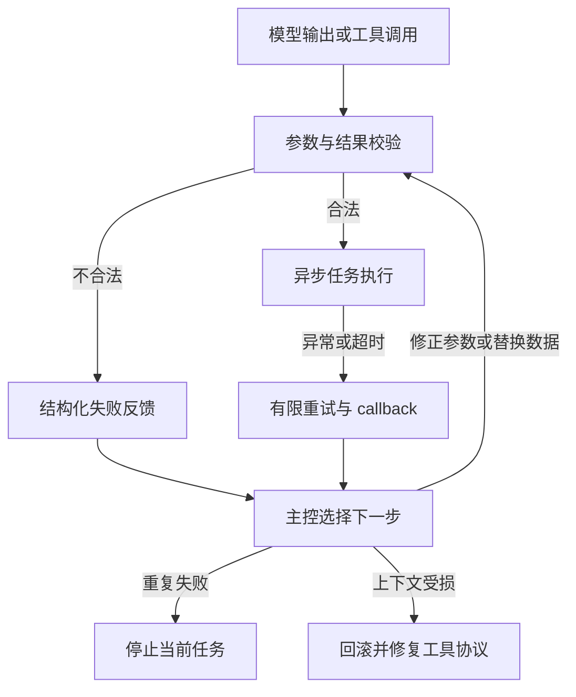

# 容错案例：参数纠错、有限重试与上下文恢复

以下案例根据 2026 年 7 月至 8 月的一组真实运行记录整理。会话身份、聊天原文、本机路径、内部标识和日志定位信息已省略；参数示例为便于说明而使用的占位内容。

TIYA 的容错由多层协作完成：确定性代码校验参数、输出和任务状态，主控再根据失败反馈选择改参、降级或停止；通信失败时，框架还需要恢复有效上下文。



## 案例一：参数错误后自行纠正

主控调用成员画像工具时，传入了 `target`、`query`，而工具 schema 要求 `user_id`。调用前的校验拒绝执行，并返回字段级原因：

```text
target：存在未声明参数
query：存在未声明参数
user_id：缺少必填参数
```

主控根据反馈改用正确字段。示意参数为：

```json
{"user_id": "example-user"}
```

修正后的调用返回空对象，主控没有持续查询同一工具，而是改用已有记忆继续准备发言任务。

这里有两个不同判断：代码保证错误参数不会直接进入工具，主控根据业务结果决定是否继续使用该数据源。工具执行成功并不意味着一定有可用数据。

## 案例二：发言模型返回空内容后停止重复尝试

一次发言任务没有得到任何可发送消息。Speaker 将其识别为业务失败，标记为可重试，并将原因与下一步建议回调给主控。

主控重试一次后仍遇到同类错误，随后停止当前任务、记录原因，等待下一次触发。后续独立触发正常完成，会话没有因这次失败永久失效。

这个案例区分了 HTTP 请求完成和有效发言结果：响应仍需通过内容与结构校验。可重试也不意味着应无限重试；本次停止重复尝试包含主控对提示和反馈的语义判断，不能推导为所有同类故障都有硬编码熔断规则。

## 案例三：上游 503 后恢复有效上下文

上游模型服务连续返回 HTTP 503。达到请求重试上限后，系统执行了以下恢复步骤：

1. 回退到上一轮完整对话。
2. 解除当前窗口中即将失效的原生 ToolCall 关联，保留仍在执行的后台任务。
3. 为未闭环 ToolCall 补充协议中止响应；孤立 ToolResponse 按通信层规则降级处理。
4. 服务恢复后，从有效 Context 继续处理后续任务。

后台任务的生命周期与某次模型请求的响应通道分别管理。窗口回滚后，主控仍可查询后台任务结果，避免因为原生响应通道失效而无条件丢弃工作。

这次记录中，服务恢复后发言链路重新完成。上下文修复改善了恢复起点，但不能保证上游服务何时恢复。

## 各层承担的职责

| 层次 | 负责的问题 | 典型动作 |
|---|---|---|
| 工具边界 | 参数或工具来源不符合要求 | 调用前拒绝，返回字段级错误 |
| 输出校验 | JSON、消息结构或内容无效 | 拒绝发送，记录原因及可重试性 |
| 任务运行时 | 工具异常、超时或取消 | 有限重试、保存终态、触发 callback |
| Agent 主控 | 失败之后是否继续 | 改参、替换数据源、停止当前尝试 |
| 上下文与通信层 | 请求失败和工具协议未闭环 | 回滚、解除失效关联、补全或降级协议消息 |

## 案例能够说明什么

这些记录展示了参数纠错、空结果降级、停止重复失败以及上下文恢复在实际运行中发生过。它们不代表每个任务最终都会成功，也不构成长时间可用性指标。

失败原因会记录并回调给主控，不保证每次都额外向群聊发送故障通知。历史观察也不能替代当前版本测试、故障注入或对全部错误类型的验证。

## 相关实现与阅读

- [Agent 主控](../src/TIYA/agent/agent.py)：工具边界、主控循环和上下文回退。
- [任务运行时](../src/TIYA/agent/agent_runtime.py)：任务异常、重试与 callback。
- [群聊 Agent / Speaker](../src/TIYA/agent/group_chat_agent.py)：发言结果校验和失败反馈。
- [LLM 通信层](../src/TIYA/LLM_connect.py)：请求构造与工具协议处理。
- [Agent 与任务机](agent-runtime.md)、[上下文与记忆](context-and-memory.md)：相关设计说明。
- [已知限制](limitations.md)：权限、沙箱与当前成熟度边界。
