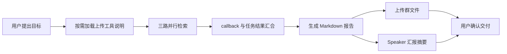

# 任务案例：并行调研与群文件交付

本案例根据 2026 年 7 月的一次真实运行记录整理，展示 TIYA 如何把自然语言目标转化为多工具任务，并交付可下载的文件。会话身份、聊天原文、本机路径、任务及消息标识已省略，时间线采用相对时间。

## 任务与结果

用户的目标可以概括为：查找 GitHub 上与 Agent 记忆有关的开源项目，整理成 Markdown 报告，并上传到当前群的群文件。

主控自行完成能力准备、三路并行检索、结果汇总、文件生成和上传，再由 Speaker 发送简短摘要。记录中存在文件生成内容、群文件消息、上传成功回执和用户确认。

## 执行过程

| 相对任务开始 | 观察到的行为 |
|---|---|
| 约 6–10 秒 | 启动三路搜索，并加载群文件上传工具的参数说明 |
| 约 45–48 秒 | 首个搜索通过 callback 返回，主控再按任务标识取回其余结果 |
| 约 72 秒 | Markdown 文件生成完成 |
| 约 80 秒 | 启动上传任务和 Speaker 汇报任务 |
| 约 91 秒 | 群内出现文件消息 |
| 约 110 秒 | Speaker 发出完成摘要 |
| 约 134 秒 | 用户确认交付 |
| 约 195 秒 | 上传子任务返回正式成功回执 |

这些时间来自一次任务的观察，受模型、网络和外部服务影响，不代表性能承诺。文件消息出现、文字汇报和上传工具回执是不同事件。

### 按需补齐工具说明

搜索和文件写入能力在任务开始前已经可用。主控确认需要上传群文件后，才加载上传工具的完整参数 schema，再按该格式调用。

这次发生的是**工具级按需加载**，并非在这一时刻重新加载完整 SKILL。能力摘要、章节说明和单个工具的 schema 可以分别获取，减少无关说明占用上下文。系统设计参见 [SKILL 系统](skills.md)。

### 并行执行与结果汇合

三路检索分别侧重项目概览、主要方案和补充项目。搜索进入后台任务后，主控通过 callback 获知结果，并通过任务查询入口汇合其他已完成的搜索，没有重新执行相同检索。

主控收到结果后才生成报告。网络等待、任务结果和会话发言由不同组件管理，相关机制参见 [Agent 与任务机](agent-runtime.md)。

### 文件与发言承担不同职责

Markdown 文件承载完整报告，群文件上传负责交付，Speaker 只发送完成状态和内容导览。这样可以保留完整产物，同时避免将长报告直接刷入群聊。

## 能力边界与改进点

- **检索不等于源码审计。** 本次使用了项目页面、搜索摘要和比较资料，没有逐仓库 clone、检查源码或核实全部 release、commit 和 README。
- **报告完整不等于资料全部准确。** 报告中的项目热度、评测和其他时效信息仍需要逐项核对来源与日期。本案例不作为相关项目的当前选型建议。
- **交付状态应以回执为准。** 此次上传和汇报并行，主控在正式上传回执前已经使用完成措辞。文件确实先于最终发言出现，但其他运行条件下可能产生错误汇报。更稳妥的流程是先报告“正在上传”，确认成功后再宣布完成；本案例不表示该流程已经修改。
- **历史案例不是当前版本验收。** 这次记录展示了能力组合与实际交付，不保证后续每次任务都成功，也不替代当前版本的回归验证。

## 相关实现

| 模块 | 职责 |
|---|---|
| [Agent 主控](../src/TIYA/agent/agent.py) | 能力查询、工具调用、任务创建与结果回收 |
| [任务运行时](../src/TIYA/agent/agent_runtime.py) | Worker 调度、重试与 callback |
| [群聊 Agent / Speaker](../src/TIYA/agent/group_chat_agent.py) | 上传入口与会话汇报 |
| [群文件 API](../src/TIYA/api/group_api.py) | OneBot 群文件上传 |

真实运行与会话隔离的说明见 [真实运行与持续演进](real-world-operation.md)。
